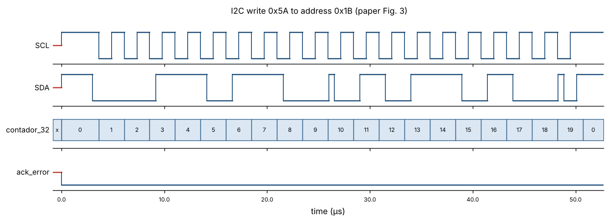
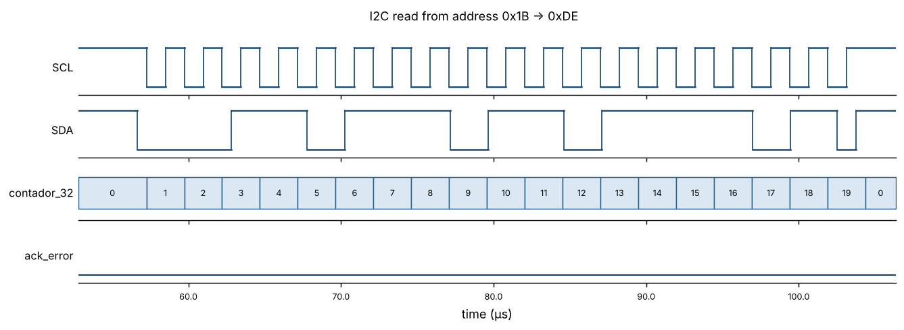
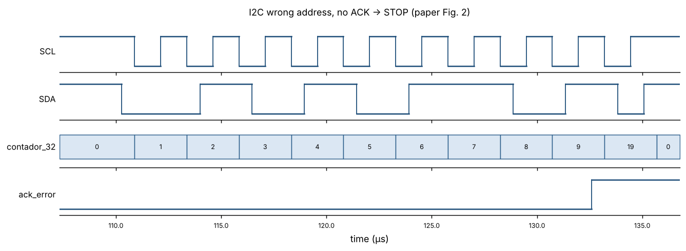
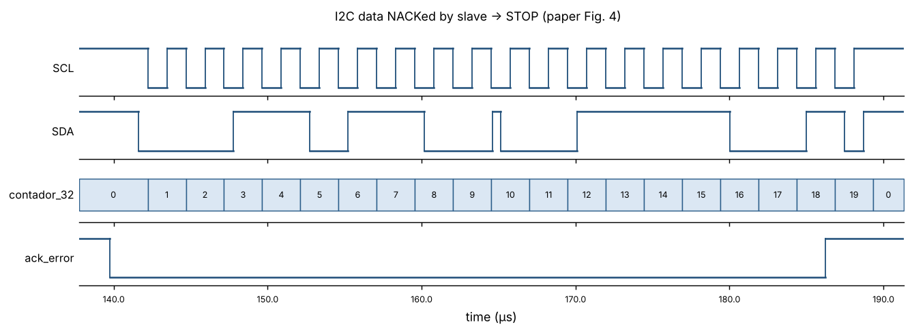
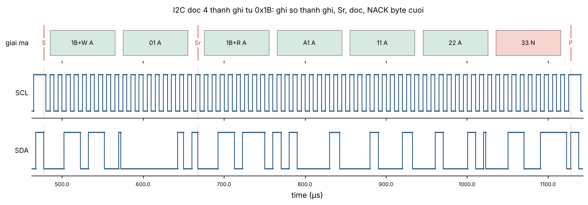
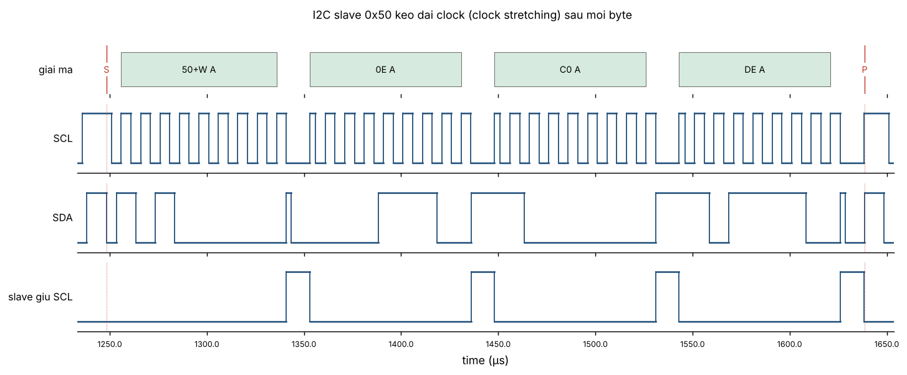
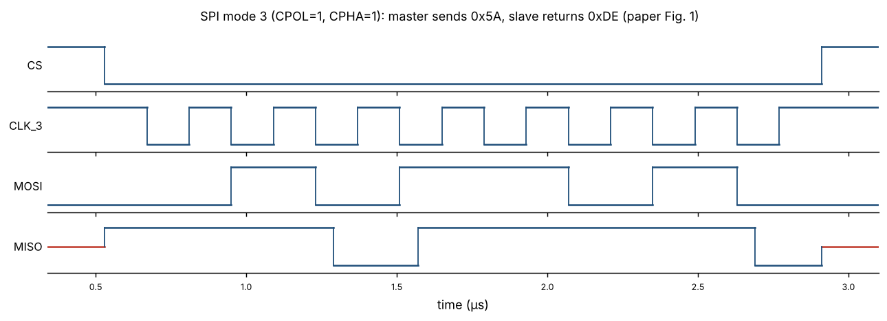

# SPI & I2C trên FPGA bằng Verilog

Mô phỏng lại cấu trúc thiết kế trong bài báo:

> T. Leal-del Río, G. Juárez-Gracia, L. N. Oliva-Moreno,
> *"Implementation of the Communication Protocols SPI and I2C Using a FPGA by the HDL-Verilog Language"*,
> Research in Computing Science 75 (2014), pp. 31–41.
> [PDF](https://www.rcs.cic.ipn.mx/2014_75/Implementation%20of%20the%20communication%20protocols%20SPI%20and%20I2C%20using%20a%20FPGA.pdf)

Repo giữ nguyên cách tổ chức của bài: module **maestro** (master) và **esclavo** (slave), bộ chia tần `contador_div`, bộ đếm bit `contador_32` điều khiển khung truyền, và bộ đệm ba trạng thái (tri-state) cho đường SDA hai chiều. Một số lỗi của bài gốc đã được sửa (xem [Khác biệt so với bài báo](#khác-biệt-so-với-bài-báo)).

## Cấu trúc thư mục

```
rtl/
  i2c/i2c_maestro.v    I2C master: START, 7-bit addr, R/W, ACK, 1 byte, STOP
  i2c/i2c_esclavo.v    I2C slave: so địa chỉ, ACK/NACK, đọc & ghi 1 byte
  i2c_full/            I2C mở rộng: nhiều byte, Sr, clock stretching, 2 slave
  spi/spi_maestro.v    SPI master full-duplex, tham số CPOL/CPHA (4 mode)
  spi/spi_esclavo.v    SPI slave full-duplex, MISO tri-state khi CS_n = 1
tb/
  tb_i2c.v             Testbench tự kiểm tra, tái hiện Fig. 2, 3, 4
  tb_spi.v             Testbench tự kiểm tra cả 4 mode SPI (Fig. 1 = mode 3)
  tb_i2c_full.v        Bus I2C 1 master + 2 slave, có bộ giải mã bus
scripts/
  plot_waves.py        Vẽ dạng sóng từ file VCD ra docs/*.png
docs/                  Hình dạng sóng đã sinh sẵn
.github/workflows/     CI: tự chạy mô phỏng khi push
```

## Chạy mô phỏng

Cần [Icarus Verilog](https://steveicarus.github.io/iverilog/) (≥ 11) và Python 3 + matplotlib (chỉ để vẽ hình).

```bash
make test     # biên dịch + chạy 3 testbench, báo PASS/FAIL
make i2c_full # chỉ chạy bản I2C đầy đủ
make waves    # sinh lại docs/*.png từ file VCD
gtkwave build/tb_i2c.vcd   # (tuỳ chọn) xem dạng sóng chi tiết
```

Kết quả mong đợi:

```
Measured f_SCL = 403.2 kHz
I2C TEST PASSED
Measured f_SCK = 3.571 MHz
SPI TEST PASSED
...
I2C FULL TEST PASSED
```

Trên Windows có thể dùng Xilinx ISE 14.7 như bài gốc: thêm các file trong `rtl/` và `tb/` vào project rồi chạy ISim với top là `tb_i2c` hoặc `tb_spi`.

## I2C

Khung truyền được tuần tự hoá bằng `contador_32` (mỗi giá trị là một "bit slot", mỗi slot chia thành 4 pha ¼ chu kỳ SCL):

| `contador_32` | Nội dung | Ai lái SDA |
|---|---|---|
| 0 | START (SDA ↓ khi SCL = 1) | master |
| 1–7 | địa chỉ A6…A0 | master |
| 8 | R/W (0 = ghi, 1 = đọc) | master |
| 9 | ACK/NACK địa chỉ | slave |
| 10–17 | dữ liệu D7…D0 | master (ghi) / slave (đọc) |
| 18 | ACK/NACK dữ liệu | slave (ghi) / master (đọc, NACK) |
| 19 | STOP (SDA ↑ khi SCL = 1) | master |

Nếu địa chỉ bị NACK ở slot 9, master nhảy thẳng tới STOP (tương ứng Fig. 2 của bài). Khi rỗi, cả SDA và SCL ở trạng thái trở kháng cao và được kéo lên bởi điện trở pull-up.

Slave đọc SDA ở **sườn lên** của SCL và đặt dữ liệu lên SDA ở **sườn xuống**, đúng như mô tả trong bài.

Giá trị dùng trong testbench lấy từ bài: địa chỉ slave `7'b0011011` (0x1B), dữ liệu ghi `8'b01011010` (0x5A), mẫu slave trả về `8'b11011110` (0xDE), địa chỉ sai `7'b0101011`.

| Kịch bản | Hình |
|---|---|
| Ghi đúng (Fig. 3) |  |
| Đọc 1 byte |  |
| Sai địa chỉ, không ACK → STOP (Fig. 2) |  |
| Slave NACK dữ liệu → STOP (Fig. 4) |  |

## I2C đầy đủ (`rtl/i2c_full/`)

Bản I2C ở trên chỉ giữ đúng phạm vi của bài báo (1 byte, không có Sr, không có clock stretching). Thư mục `rtl/i2c_full/` là bản mở rộng, mô phỏng một bus I2C gần với thực tế hơn:

| Module | Mô tả |
|---|---|
| `i2c_master_byte.v` | Master nhận lệnh từng bước: `START` (cũng dùng cho Sr), `WRITE` byte, `READ` byte kèm ACK/NACK, `STOP`. Có chờ khi slave kéo dài clock. |
| `i2c_slave_regs.v` | Slave có 16 thanh ghi 8 bit, con trỏ thanh ghi tự tăng, hỗ trợ Sr, tham số `STRETCH_CYC` để bật clock stretching. |
| `tb/tb_i2c_full.v` | Một master và hai slave (0x1B và 0x50) trên cùng bus, có bộ giải mã bus in log từng giao dịch. |

Hai giao dịch được mô phỏng:

```
Ghi:  S | addr+W | A | reg | A | data0 | A | data1 | A ... | P
Đọc:  S | addr+W | A | reg | A | Sr | addr+R | A | data0 | A ... | dataN | N | P
```

Log khi chạy `make i2c_full`:

```
T1: ghi 3 byte 11 22 33 vao slave 0x1B, thanh ghi 0x02
    [    7.1 us] S 36(1b W) A 02 A 11 A 22 A 33 A P
T2: doc 4 byte tu slave 0x1B, bat dau tai 0x01 (co Sr)
    [  477.6 us] S 36(1b W) A 01 A
    [  667.7 us] Sr 37(1b R) A a1 A 11 A 22 A 33 N P
T3: goi dia chi 0x2B (khong co ai)
    [ 1138.2 us] S 56(2b W) N P
T4: slave 0x50 keo dai clock (clock stretching)
    [ 1248.3 us] S a0(50 W) A 0e A c0 A de A P
    [ 1648.7 us] S a0(50 W) A 0e A
    [ 1848.9 us] Sr a1(50 R) A c0 A de N P
    SCL thap lau nhat: 12.1 us
I2C FULL TEST PASSED
```




SCL chạy ở 100 kHz (Standard-mode), chia đều 5 µs thấp / 5 µs cao, đáp ứng yêu cầu t_LOW ≥ 4,7 µs và t_HIGH ≥ 4,0 µs của chuẩn. Chưa hỗ trợ: phân xử đa master và địa chỉ 10 bit.

Để dùng `i2c_master_byte` trên phần cứng, cần thêm một FSM (hoặc CPU mềm) ra lệnh theo đúng thứ tự như các task `write_regs` / `read_regs` trong testbench.

## SPI

Master phát `CLK_3`, `CS` tích cực mức thấp, kết thúc khung ở sườn lên của `CS`, truyền song công (MOSI và MISO cùng lúc). Mode do tham số `CPOL`/`CPHA` quyết định; mặc định là mode 3 như bài.

| Mode | CPOL | CPHA | Lấy mẫu | Đổi dữ liệu |
|---|---|---|---|---|
| 0 | 0 | 0 | sườn lên | sườn xuống |
| 1 | 0 | 1 | sườn xuống | sườn lên |
| 2 | 1 | 0 | sườn xuống | sườn lên |
| 3 | 1 | 1 | sườn lên | sườn xuống |



## Tham số

| Module | Tham số | Mặc định | Ghi chú |
|---|---|---|---|
| `i2c_maestro` | `CLK_HZ`, `SCL_HZ` | 50 MHz, 400 kHz | đặt `SCL_HZ` = 100 000 cho Standard-mode |
| `i2c_esclavo` | `MY_ADDR` | `7'b0011011` | |
| `spi_maestro` | `CLK_HZ`, `SCK_HZ`, `N`, `CPOL`, `CPHA` | 50 MHz, 3.6 MHz, 8, 1, 1 | f_SCK thực = 50 MHz / 14 = 3.571 MHz |
| `spi_esclavo` | `N`, `CPOL`, `CPHA` | 8, 1, 1 | yêu cầu `clk_50` ≥ ~8 × f_SCK |

## Tài nguyên (ước lượng)

Tổng hợp bằng Yosys `synth_xilinx -family xc3se` (Spartan-3E). Đây chỉ là ước lượng; số liệu từ Xilinx ISE sẽ khác.

| Module | Flip-flop | LUT |
|---|---|---|
| `i2c_maestro` | 41 | 115 |
| `i2c_esclavo` | 40 | 53 |
| `spi_maestro` | 36 | 29 |
| `spi_esclavo` | 34 | 20 |
| `i2c_master_byte` | 52 | 76 |
| `i2c_slave_regs` | 180 | 369 |

Phần lớn tài nguyên của `i2c_slave_regs` là 16 × 8 bit thanh ghi. Chúng được reset về giá trị ban đầu nên được tổng hợp thành flip-flop chứ không phải RAM phân tán.

## Khác biệt so với bài báo

| Vấn đề trong bài | Cách xử lý ở đây |
|---|---|
| Logic chạy theo clock chia (`clk_3`) và theo sườn SCL | Toàn bộ đồng bộ theo `clk_50`, dùng xung cho phép (clock-enable); slave đồng bộ SDA/SCL/SCK qua 2 flip-flop |
| f_SCL ghi là 396 kHz nhưng bộ chia (đảo ở 67, reset ở 68) cho ~360–368 kHz | Tần số là tham số, tính có làm tròn; testbench đo và in ra tần số thực |
| Nói CPOL = CPHA = 1 nhưng mô tả lấy mẫu ở sườn xuống (mâu thuẫn với mode 3) | Dùng định nghĩa chuẩn của CPOL/CPHA, hỗ trợ và kiểm thử cả 4 mode |
| Không có FSM tường minh, START/STOP sinh theo sườn clock | Mỗi bit slot chia 4 pha để SDA chỉ đổi khi SCL = 0 (trừ START/STOP) |
| Không có mã SPI, không có testbench | Có đủ RTL SPI và testbench tự kiểm tra (PASS/FAIL) |
| Lỗi cú pháp (`0'b0`), độ rộng mẫu thử không thống nhất | Đã sửa |

Giống bài gốc, bản `rtl/i2c/` **không** hỗ trợ phân xử đa master, clock stretching, truyền nhiều byte và địa chỉ 10 bit. Bản `rtl/i2c_full/` bổ sung truyền nhiều byte, Sr và clock stretching.

## Đưa lên phần cứng

RTL tổng hợp được cho Spartan-3E, nhưng repo chưa có module top và file ràng buộc chân (`.ucf`) vì phụ thuộc board. Khi nạp lên board cần lưu ý:
- SDA/SCL phải là chân `inout`, có điện trở pull-up (thường 2.2–4.7 kΩ) hoặc bật `PULLUP` trong UCF.
- `rst_n` và `start` nên lấy từ nút bấm đã chống dội (debounce).
